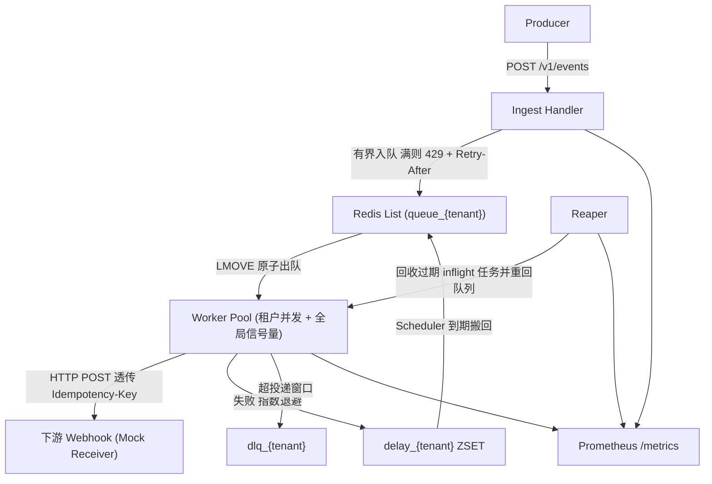

# Webhook Relay

租户感知的 Webhook 中继服务——以 At-Least-Once 语义可靠地把事件投递到各租户的下游 HTTP 端点，用两级并发隔离租户、退避+DLQ 处理失败、租约+fencing token 保证崩溃恢复，全程 Prometheus 可观测。

## 核心架构



投递任务的流转：`queue:{tenant}`（待投）→ `inflight:{tenant}`（在途，持租约 + fencing token）→ 终态（`delivered` / `dlq`），失败则经 `delay:{tenant}` 退避后重回队列。reaper 负责回收 worker 崩溃留下的孤儿任务。

## 核心设计决策

1. **At-Least-Once + 幂等键透传**：投递的歧义窗口内"重试则可能重复、不重试则可能丢失"，中继选择重试（宁重复不丢）；幂等键由中继生成（`{tenant}:{producer_key}` 或 UUID）并透传 `Idempotency-Key` 头——**把去重交给唯一能实现它的接收方**。
2. **两级并发隔离**：每租户 worker 池限制单租户爆炸半径，全局信号量限制进程资源；队列满立即 429 + `Retry-After` 而非阻塞——**用背压（拒绝）换 ingest 延迟的可预测性**。
3. **指数退避 + full jitter + DLQ**：失败进 `delay` 有序集合调度，超投递窗口进 DLQ 终止——**full jitter 打散重试惊群，窗口给"无限重试"一个终点**。
4. **租约 + fencing token + reaper**：worker 持 30s 可续租约投递，fencing token 单调递增做 CAS 拒旧写，reaper 原子回收租约过期的孤儿任务——**不用分布式锁：租约给活性、fencing 给安全、reaper 给回收**。
5. **全链路观测性**：ingest / 投递 / 退避 / 租约接管 / 旧写拒都有 Prometheus 指标，故障注入脚本直接断言 `/metrics`——**指标既是观测手段，也是故障验证的断言来源**。

## 快速开始

```bash
docker compose up -d
```

四个容器：relay（`8080`，ingest + `/metrics`）、mock（`9000`，可控下游）、redis（`6379`，AOF everysec）、prometheus（`9091`）。

投递一个事件：

```bash
curl -X POST localhost:8080/v1/events \
  -H 'Content-Type: application/json' -H 'X-Tenant-ID: t1' \
  -d '{"producer_key":"e1","payload":{"a":1}}'
# → 202；随后 relay 投递到 mock，可 curl localhost:9000/__requests 查看
```

> 国内网络首次构建前，需在 `~/.docker/daemon.json` 配置镜像加速器（如 `https://docker.m.daocloud.io`）。详见 `docs/design-webhook-relay.md`。

## 验证结果

测试环境：Windows 11 单机，hey 1000 请求 × 50 并发；chaos 用本地 miniredis（`cmd/devredis`），docker compose 端到端用 Redis 7 单独验证通过。

| 场景 | 结果 |
|---|---|
| **bench**（1000 req / 50 并发） | 吞吐 **819.8 req/s**；P50 24.4ms / P90 50.5ms / **P99 723ms**；1000×202、**0 429** |
| **chaos-a**（kill worker） | `PASS deliveries=2`——kill 后 reaper 接管，同 key 重投 |
| **chaos-b**（Redis 宕机） | 202 → 停 Redis → **503** → 恢复 → `redis_up 1` |
| **chaos-c**（下游 500） | `webhook_delivery_attempts{500}=2`，退避延迟 ~1s / ~1.8s（full jitter） |
| **chaos-d**（多租户过载） | 5 慢租户挂起时，健康租户 ingest 202 @ **175ms**（未阻塞） |

## 已知限制

- **时钟漂移**：租约/续租用 worker 进程 `time.Now()`，单机部署安全；多机部署需换 Redis `TIME` 对齐。
- **下游 `Retry-After`**：仅解析整数秒（不解析 HTTP-date 格式），且封顶 60s。
- **ingest 不限制 payload 大小**、不强制 Content-Type，未知 JSON 字段被忽略。
- **`deliver` 无界读响应体**：恶意下游可致大内存分配。
- **`state.Get` 吞解析错误**：畸形的 `attempt_count`/`fencing_token` 静默为 0。
- **关闭无优雅 drain**：无 `WaitGroup` 等待 worker/reaper/scheduler，进程退出即终止（在途任务由下次 reaper 回收）。
- **drain rate 为间隔法 EWMA 近似**：非严格 60s 滑窗，冷启动回退 1 event/s。
- **入站幂等去重、payload 签名、下游鉴权**为显式非目标（设计 §0）。

## 技术栈与文档

Go 1.27 · Redis 7 · Prometheus · go-redis/v9 · miniredis（测试）

- 设计文档：`docs/design-webhook-relay.md`
- 实现计划：`docs/implementation-plan.md`
- 故障注入：`make chaos-a|b|c|d`，压测 `make bench`，单测 `make test`
